<p align="center"></p>

# AEGIS AI — Real-Time Financial Intelligence, Fraud Detection & Autonomous Investigation Platform

[](../../actions/workflows/ci.yml)


AEGIS AI is a runnable, end-to-end fraud-intelligence platform. Synthetic payment events stream through
**Redpanda (Kafka API)** into a Python consumer. The consumer validates, deduplicates and featurises each event,
then scores it with a **scikit-learn** model and persists the result atomically to **PostgreSQL**. A **LangGraph**
workflow investigates alerts using only evidence retrieved from the database. **dbt Core** builds analytical marts,
and a **React + TypeScript** analytics workspace (clean white-and-blue design system, Tailwind + Recharts) shows all of it live.

> **Everything is synthetic.** All customers, merchants, devices and transactions are artificial and generated
> from a fixed seed. This is a research and review platform. It makes **no automated financial decisions**.

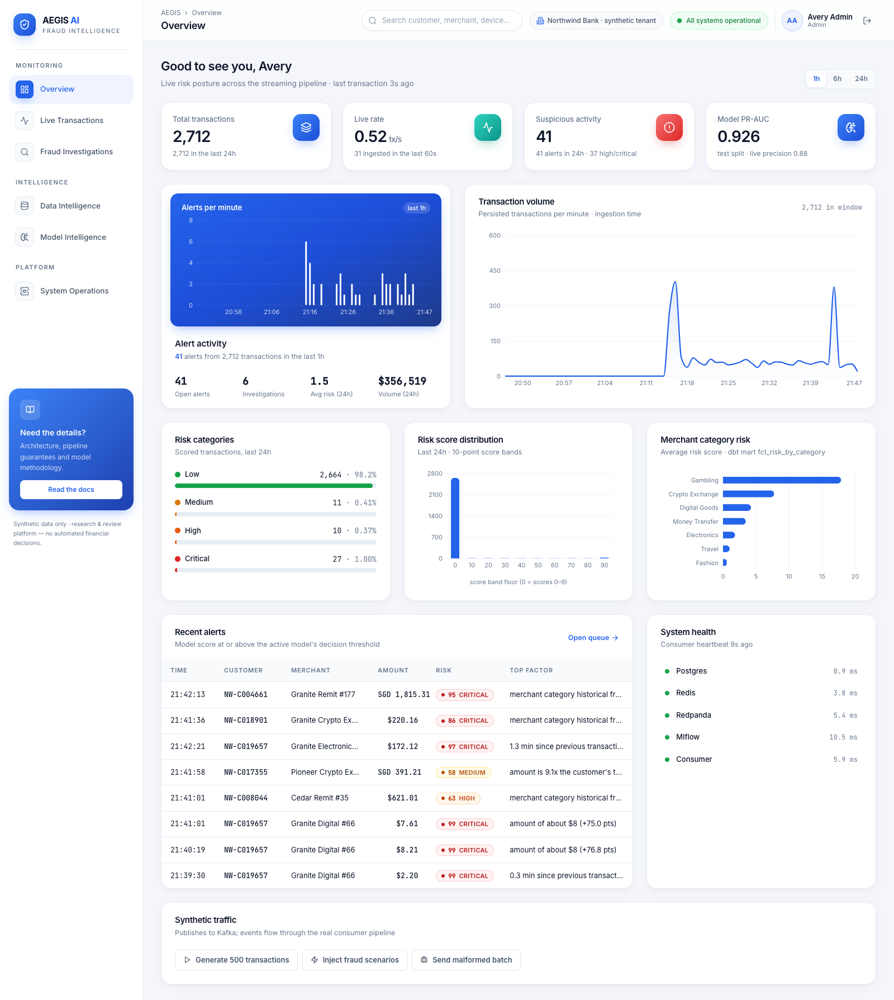

---

## Contents
[Problem](#problem-statement) · [Features](#major-features) · [Stack](#technology-stack) · [Architecture](#architecture) ·
[Quick start](#installation--one-command-startup) · [Demo](#demo-walkthrough) · [API](#api-endpoints) ·
[Database](#database-architecture) · [ML](#machine-learning-methodology) · [Metrics](#actual-model-evaluation-metrics) ·
[Data quality](#data-quality-strategy) · [Investigations](#ai-investigation-workflow) · [Testing](#testing) ·
[CI/CD](#cicd) · [Security](#security-considerations) · [Limitations](#known-limitations) · [Future work](#future-improvements)

## Problem statement

Card fraud has to be caught **while the payment is happening**. Analysts then need to know *why* something was flagged
before they act. That needs several things working together:

- a streaming pipeline that stays correct under real-world mess: duplicate deliveries, out-of-order events,
  malformed payloads and consumer crashes;
- features computed identically offline (training) and online (serving), with no label leakage;
- a model whose performance is measured honestly and whose individual scores can be explained;
- an investigation workflow that gathers evidence and never invents it;
- multi-tenant isolation, observability and data-quality controls around all of the above.

AEGIS implements that loop at laptop scale with production-style engineering.

## Major features

| Area | What is implemented |
|---|---|
| **Synthetic engine** | Seeded generator: 60,000 customers and 1,200 merchants across 2 tenants. Normal traffic follows each customer's time-of-day habits. Five fraud scenarios (card-testing bursts, account takeover, high-value anomalies, impossible travel, collusive merchants). Hard negatives (legit travel, new phones, big purchases). Injected defects: duplicates, invalid records, out-of-order and stale events. |
| **Streaming pipeline** | Idempotent producer → `transactions.v1` (3 partitions) → consumer that validates against a versioned JSON schema, checks referential integrity, applies per-partition event-time watermarks (late vs stale), deduplicates by id + content hash, featurises with Redis, scores, and persists atomically. Offsets are committed **only after** the DB commit. Invalid events go to the `transactions.dlq` topic **and** a quarantine table. |
| **Storage & analytics** | PostgreSQL with Alembic migrations, CHECK constraints, composite FKs and documented indexes. dbt Core: 3 staging views, 7 marts, 23 data tests, run every 2 minutes; results are recorded and shown in the UI. |
| **Machine learning** | Point-in-time features shared by training and serving. Chronological 70/15/15 split. Logistic-regression baseline vs. histogram gradient boosting with class weighting. Platt calibration, F1-optimal threshold, permutation importance, MLflow tracking, model registry with hot-swap, PSI drift monitoring. |
| **Explanations** | Per-transaction *single-feature baseline substitution*: each feature's contribution is the change in the real model's probability when that feature is reset to its training median. These are real counterfactuals, not made-up weights. |
| **Investigations** | LangGraph state machine with 6 tenant-scoped evidence tools. Rule-based indicators cite evidence IDs; priority P1–P4; timeline; limitations. Optional **Ollama** narration behind a grounding gate: citations must exist and every number must appear in the evidence. The UI shows whether the LLM or the deterministic engine was used. |
| **Dashboard** | White-and-blue design system (semantic tokens, gradient stat cards, CVD-validated chart palette). Six pages: Overview, Live Transactions (SSE with reconnect + polling fallback), Fraud Investigations, Data Intelligence, Model Intelligence, System Operations, plus a global transaction search in the top bar. Each has loading, empty, error and reconnection states. |
| **Security** | JWT (HS256), bcrypt, three roles (admin/analyst/viewer), tenant predicates in every query, audit log, parameterised SQL, server-side validation, non-root containers, secret scanning in CI. |
| **Observability** | structlog JSON logs with request IDs, `/health/live` and `/health/ready`, Prometheus metrics on the API and consumer, pipeline windows in Postgres, 10 scheduled DQ checks, optional Prometheus + Grafana profile. |

## Technology stack

**Backend:** Python 3.11, FastAPI, Pydantic v2, SQLAlchemy 2 Core + psycopg 3, Alembic, confluent-kafka, redis-py, structlog, prometheus-client, PyJWT, bcrypt
**Streaming & storage:** Redpanda v24 (Kafka API), PostgreSQL 16, Redis 7
**ML/AI:** scikit-learn 1.9, pandas, NumPy, MLflow 3, LangGraph, optional Ollama (`llama3.2:3b`)
**Analytics:** dbt Core 1.9 (dbt-postgres)
**Frontend:** React 18, TypeScript 5, Vite, Tailwind CSS, TanStack Query, Recharts, lucide-react
**Quality:** pytest, Vitest + Testing Library, Playwright, ruff, mypy, ESLint, gitleaks
**Ops:** Docker Compose (health-checked, ordered startup), GitHub Actions, nginx, optional Prometheus + Grafana

## Architecture

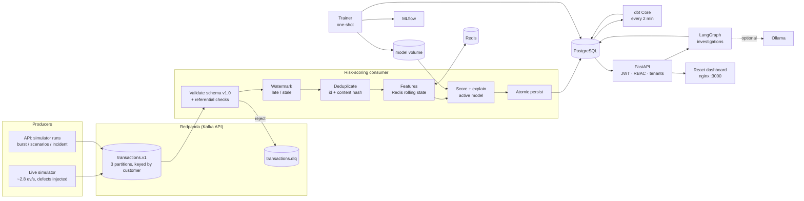

**Why these services.** The **consumer** is separate from the **API** so a traffic spike can't starve user requests,
and so scoring scales by adding Kafka partitions and consumer instances. Training is a **one-shot job**, not a
service. **dbt** runs on a schedule because analytics are batch by nature. The design has no other microservices.
Details are in [docs/ARCHITECTURE.md](docs/ARCHITECTURE.md) and [docs/DECISIONS.md](docs/DECISIONS.md).

### Streaming data flow

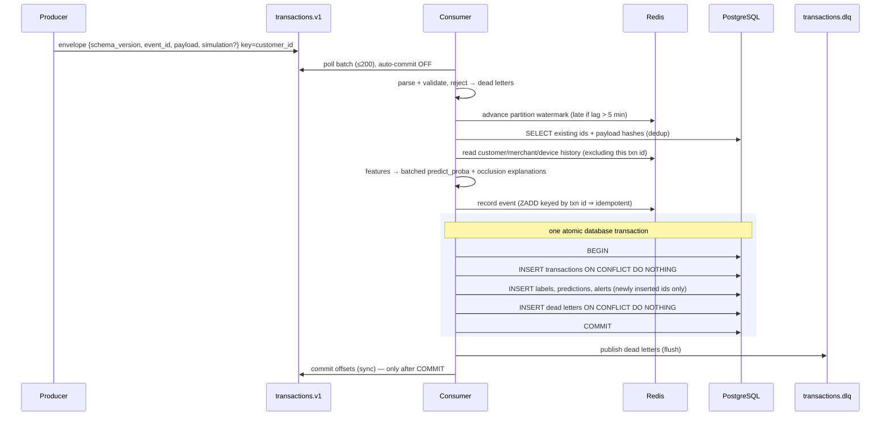

A crash anywhere before the offset commit causes redelivery. Redelivery is harmless:
transactions are keyed by `transaction_id`, Redis writes are keyed by `transaction_id`, and the feature reader
excludes the transaction being scored. The integration test suite **proves** that a replayed batch creates zero new rows and leaves
stored scores unchanged. See [docs/DATA_PIPELINE.md](docs/DATA_PIPELINE.md).

## Installation & one-command startup

**Prerequisites:** Docker with Compose v2 (Docker Desktop, Colima or Rancher Desktop) with ≥ 6 GB RAM for the VM,
GNU Make, Python 3.10+ (only for the host-side smoke test), and Node 22 + `uv` or Python 3.11 if you want to run
tests locally. No cloud accounts, API keys or paid services are needed.

```bash
git clone https://github.com/Sreevarshann/aegis-ai-real-time-fraud-platform.git
cd aegis-ai-real-time-fraud-platform
make demo
```

`make demo` creates `.env` from `.env.example` (non-production values) and builds all images. It then starts
Postgres, Redis, Redpanda and MLflow, runs migrations, seeds 2 tenants with 5 demo users and 60k synthetic customers,
**trains and registers the model** (~50 s), and starts the consumer, API, live simulator, dbt and UI. It waits on
health checks and fails loudly with logs if any step breaks. Finally it injects the fraud-scenario pack, builds the
dbt marts and runs the end-to-end smoke test.

| URL | What |
|---|---|
| http://localhost:3000 | Dashboard. Sign in as `admin@northwind.demo`, `analyst@northwind.demo`, `viewer@northwind.demo` or `analyst@meridian.demo`. The password is `AEGIS_DEMO_USER_PASSWORD` from `.env`. |
| http://localhost:8000/docs | OpenAPI (Swagger) |
| http://localhost:5050 | MLflow experiments |
| http://localhost:9108/metrics · http://localhost:8000/metrics | Prometheus metrics (consumer · API) |

Other targets: `make setup` (local tooling + image build) · `make up` · `make test` · `make lint` · `make test-e2e` ·
`make screenshots` · `make incident` · `make train` · `make logs` · `make down` · `make clean`.

Optional profiles:
```bash
docker compose --profile monitoring up -d   # Prometheus :9090 + Grafana :3001 (pre-provisioned "AEGIS pipeline" dashboard)
docker compose --profile llm up -d ollama && docker compose exec ollama ollama pull llama3.2:3b
# then set AEGIS_OLLAMA_ENABLED=true in .env and `docker compose up -d api`
```

## Demo walkthrough

A full script with expected output is in [docs/DEMO.md](docs/DEMO.md). In short:

0. **Sign in**: split-screen login. Pick a demo account; the tenant comes from the JWT, never from the UI.
1. **Overview**: KPI cards (total, live rate, suspicious activity, model PR-AUC), a 1h/6h/24h window toggle, alert
   activity and transaction volume charts, risk categories and score distribution, merchant-category risk from the dbt
   mart, recent alerts with their top factor, and service health.
2. **Generate traffic**: as admin, press *Generate 500 transactions* or *Inject fraud scenarios*. Events go through Kafka and
   the real consumer.
3. **Live Transactions**: the SSE feed flashes new rows. Filter, search (also from the top bar) and click a row to see the model explanation,
   the Kafka partition/offset and every feature value.
4. **Fraud Investigations**: press *Investigate* on an alert. The report shows indicators, cited evidence, a timeline,
   the recommended action and limitations. Record a review decision; the alert status follows it.
5. **Data Intelligence**: summary cards (checks passing, quarantined events, dbt nodes, completeness), a quality
   trend, DQ checks, the quarantine table and reasons, dbt run results and the analytical marts.
6. **Model Intelligence**: real test metrics, confusion matrix, candidate comparison, per-scenario recall, feature
   importance, PSI drift and live performance against simulator labels.
7. **System Operations**: an overall health banner, service health, consumer counters and latency, throughput,
   pipeline errors and the audit log.
8. **Incident drill**: `make incident` sends one message of every defect class. All are quarantined
   ([docs/DEMO.md#incident](docs/DEMO.md#incident-scenario-malformed-data-is-quarantined)).

| | |
|---|---|
| 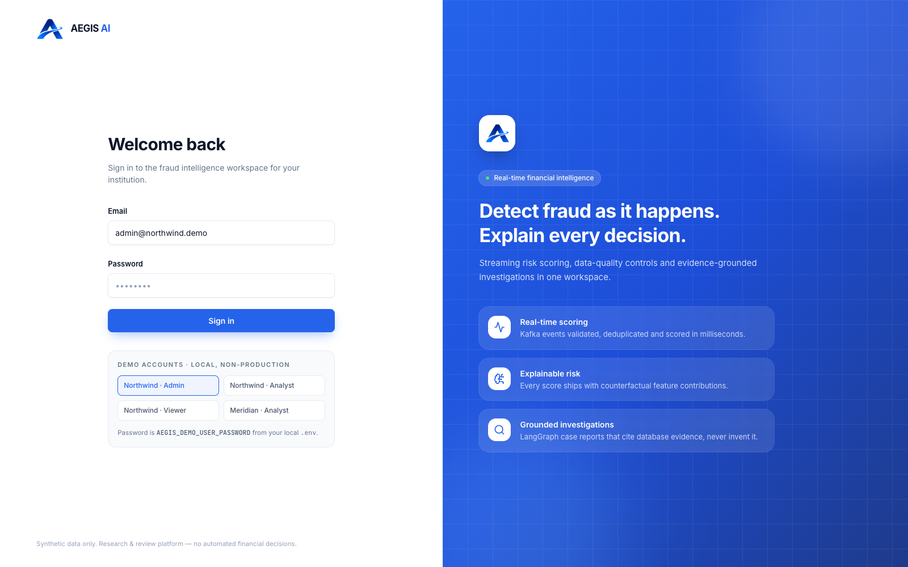 | 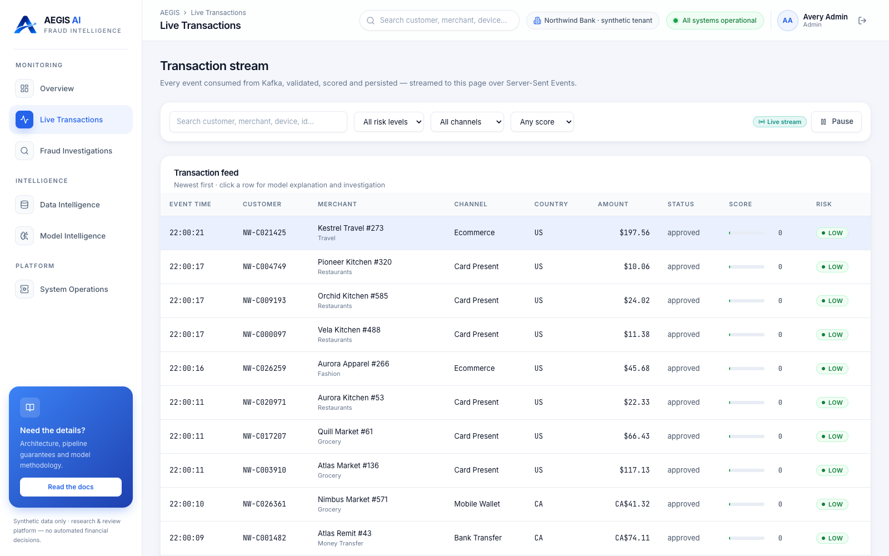 |
| 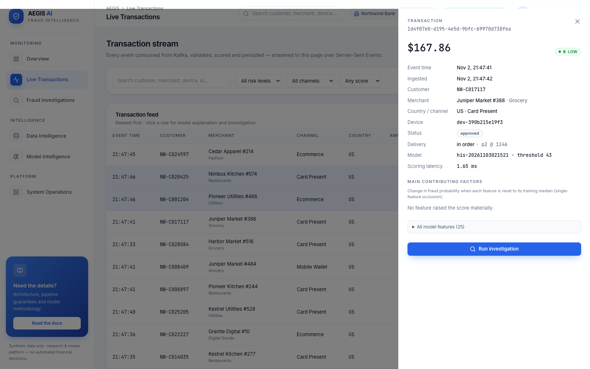 | 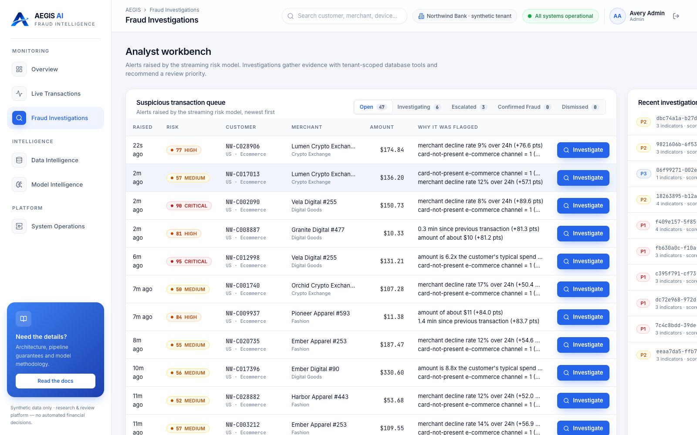 |
| 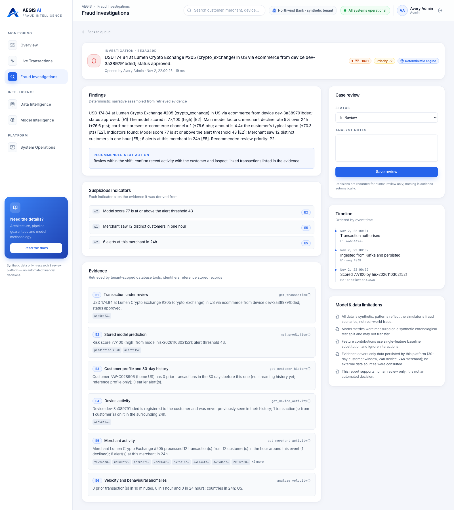 | 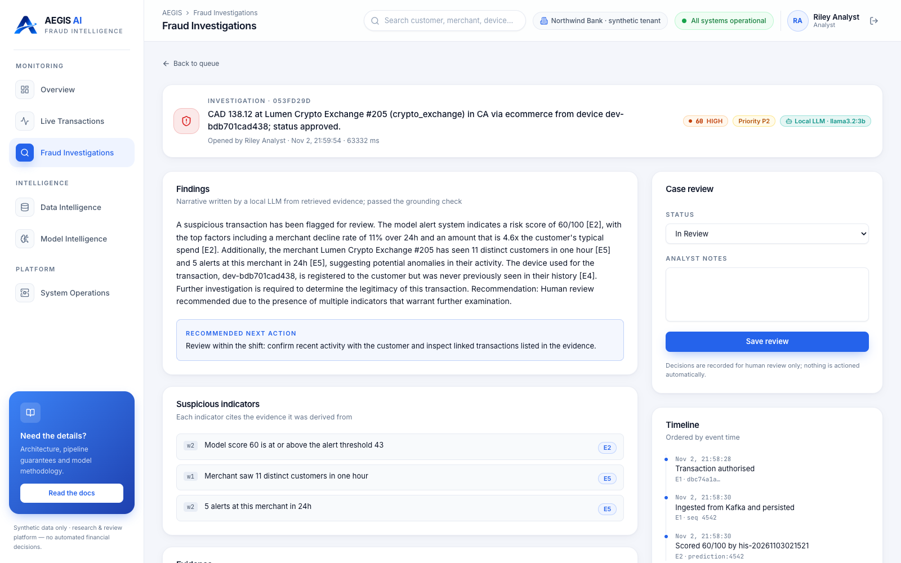 |
| 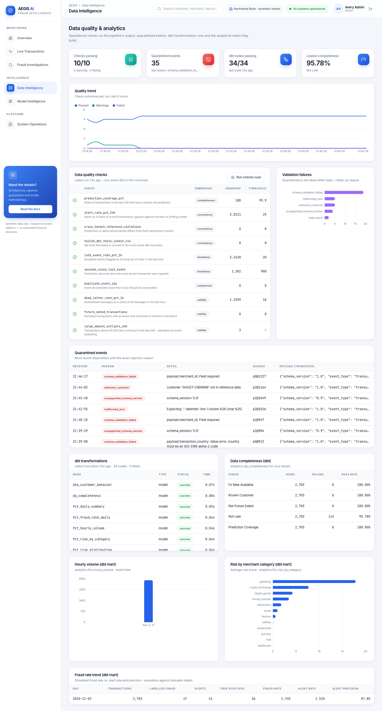 | 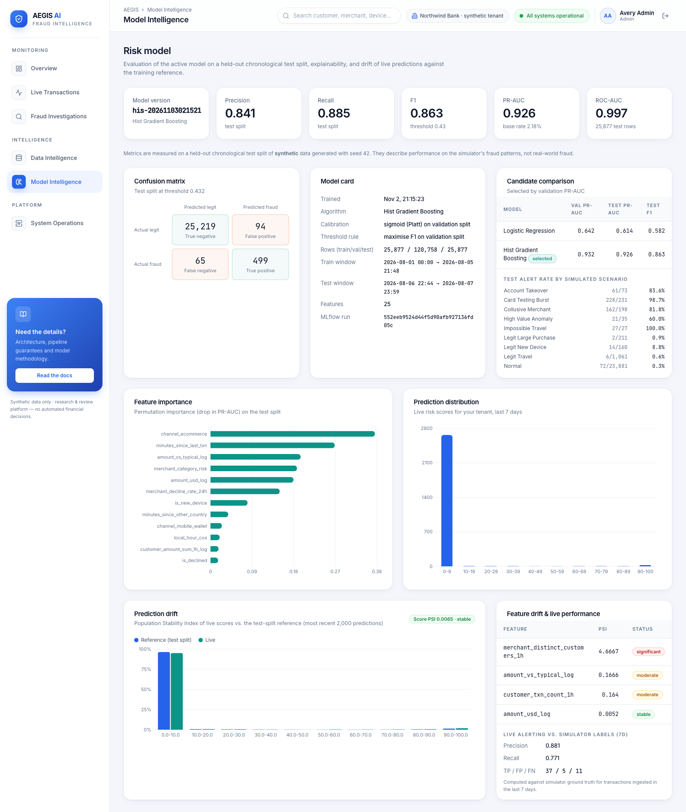 |
| 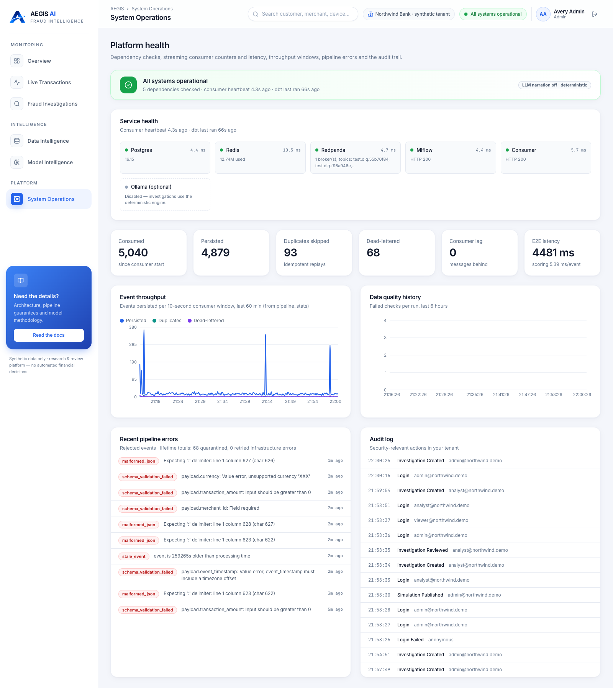 | |

All ten screenshots were captured by Playwright (`make screenshots`, i.e. `frontend/e2e/screenshots.spec.ts`) from the
running stack after the white-and-blue redesign. The LLM screenshot shows an investigation narrated by a local
`llama3.2:3b` model that passed the grounding gate; the other reports use the deterministic engine.

## API endpoints

All business endpoints live under `/api/v1`. They require `Authorization: Bearer <JWT>` and are scoped to the
caller's tenant. Full reference: [docs/API.md](docs/API.md).

| Method | Path | Role | Purpose |
|---|---|---|---|
| POST | `/auth/login` · GET `/auth/me` | — / any | Obtain JWT · current user |
| GET | `/overview` | any | KPIs, volume series, risk distribution, recent alerts |
| GET | `/transactions` · `/transactions/{id}` · `/transactions/stream` | any | Filtered/paginated feed · detail + explanation · SSE live feed |
| GET/PATCH | `/alerts` · `/alerts/{id}` | any / analyst | Alert queue · change status |
| POST/GET/PATCH | `/investigations` · `/investigations/{id}` | analyst / any / analyst | Run LangGraph investigation · read · review |
| GET | `/models/active` · `/models` · `/models/drift` | any | Metrics, importance, live performance · registry · PSI drift |
| GET/POST | `/data-quality` · `/data-quality/run` | any / analyst | Latest + historical checks · run now |
| GET | `/dead-letters` · `/analytics` | any | Quarantine · dbt marts + run results |
| GET | `/operations/health` · `/operations/pipeline` · `/operations/audit` | any / any / admin | Dependencies · throughput & consumer metrics · audit log |
| POST | `/simulator/runs` | admin | Publish burst / scenario pack / incident to Kafka |
| GET | `/health/live` · `/health/ready` · `/metrics` | public | Liveness · readiness (DB + active model) · Prometheus |

## Database architecture

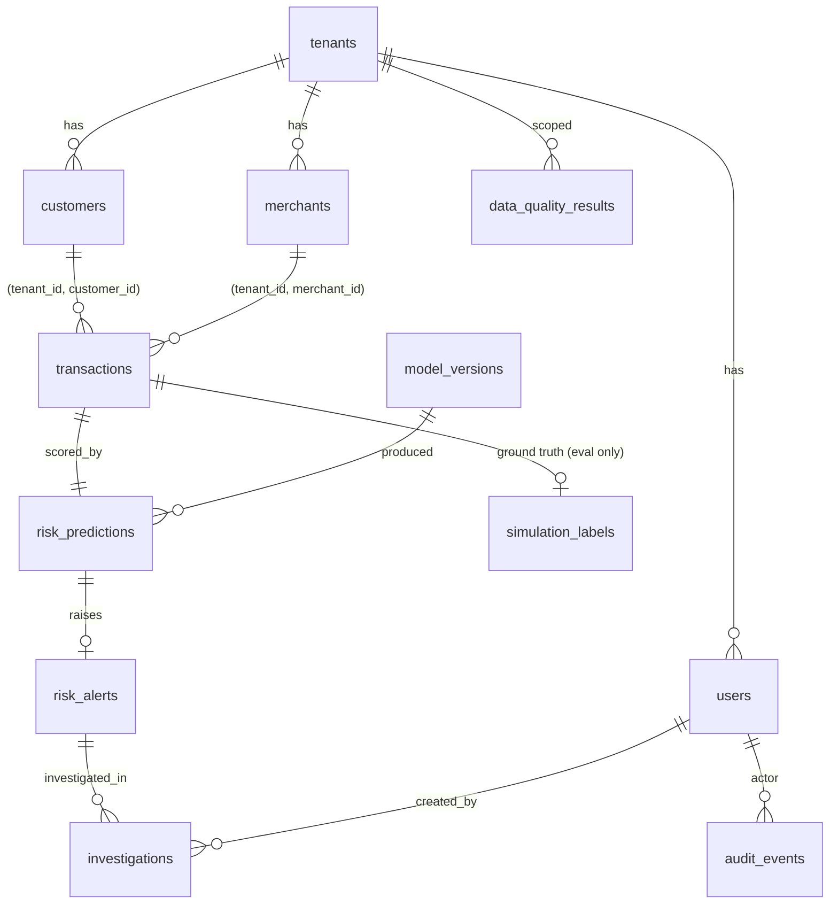

Plus `dead_letter_events` (unique on topic/partition/offset), `pipeline_stats`, `transformation_runs`,
`data_quality_results` and `audit_events`. Every tenant-facing index leads with `tenant_id`. A partial unique
index allows at most one active model. CHECK constraints cover amounts, score ranges, categories and statuses.
Full DDL rationale and index list: [docs/ARCHITECTURE.md#database](docs/ARCHITECTURE.md#database).

**Data lineage**

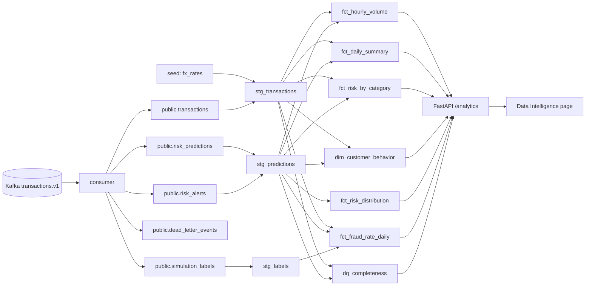

## Machine learning methodology

Summary below; details in [docs/ML_MODEL.md](docs/ML_MODEL.md).

- **Data.** 172,512 events from an independent seeded population of 3,000 customers per tenant over 7 days.
  The customer-to-merchant density matches the live population, so merchant-velocity features are on the same
  scale offline and online (a real train/serve skew bug found and fixed during development; see DECISIONS).
- **Features (25).** Amount (log, vs typical, z-score vs own history), customer velocity (1h/24h counts, 1h spend,
  minutes since last), time of day (cyclic + rarity for this customer), device novelty and sharing, foreign/new country,
  minutes since a transaction in another country, merchant velocity, distinct customers and decline rate, channel,
  decline flag, account age, and target-encoded merchant-category risk (fit on the training split only).
  Missing-by-design values stay `NaN`.
- **No leakage.** The label lives in a separate `simulation` block that is split off before the scoring path. The
  `TransactionPayload` model has no label field and rejects extra fields (unit-tested). The split is chronological.
  Category encoding uses training data only.
- **Imbalance.** ~2.1% positives, handled with `class_weight="balanced"`. Evaluation uses PR-AUC, not accuracy.
- **Model selection.** LR baseline vs `HistGradientBoostingClassifier`. Both are Platt-calibrated on validation and
  selected by validation PR-AUC. The threshold maximises validation F1. **Test is untouched until the end.**
- **Reproducibility.** `make train` (or `python -m aegis.ml.train --seed 42`) gives bit-identical metrics on the same
  container image (verified twice). Numerics differ slightly across CPU architectures and BLAS builds.

## Actual model evaluation metrics

Active model `his-20261102233520`, measured on the held-out **chronological test split** (25,877 transactions,
564 fraud = 2.18%) at decision threshold 0.432:

| Model | Precision | Recall | F1 | PR-AUC | ROC-AUC |
|---|---|---|---|---|---|
| Logistic regression (baseline) | 0.564 | 0.601 | 0.582 | 0.614 | 0.976 |
| **Hist. gradient boosting (selected)** | **0.842** | **0.885** | **0.863** | **0.926** | **0.997** |

Confusion matrix (selected): TN 25,219 · FP 94 · FN 65 · TP 499.

Test alert rate by simulated scenario: card-testing 98.7% · impossible travel 100% (27) · account takeover 83.6% ·
collusive merchant 81.8% · high-value anomaly 60.0% (35) · normal 0.30% · legit travel 0.57% · legit new device 8.8% ·
legit large purchase 0.95%.

**On the live stream** (same model, measured against simulator labels at the time of writing): 7,628 normal transactions →
38 alerts (0.5%); card testing 80/84; account takeover 19/20; collusive merchant 21/28.

> These numbers describe the model's performance on **this simulator's** fraud patterns. Synthetic fraud is cleaner
> than real fraud, so they say nothing about real-world performance. The value of the project is the pipeline and the
> methodology, not the headline AUC.

## Data quality strategy

Validation happens in three layers:
1. **At ingestion**, every message passes a versioned Pydantic contract (types, enums, ISO codes, positive amounts,
   tz-aware timestamps, safe identifiers, no extra fields). Referential checks follow: tenant, customer, merchant and
   category consistency. Then come time checks (future-dated, stale vs processing time, stale vs partition watermark)
   and dedup (exact replay vs conflicting reuse). Failures are quarantined with a stable reason code to both the DLQ
   topic and `dead_letter_events`, and the raw payload is preserved and NUL-escaped.
2. **In the database**, CHECK, FK and UNIQUE constraints mean even a buggy writer cannot persist invalid state.
3. **Continuously**, 10 SQL checks run every 60s (completeness, uniqueness, validity, timeliness, consistency,
   including cross-tenant reference violations and failed dbt tests). The 23 dbt tests run every 2 minutes, including
   reconciliation of mart totals against staging.

The data-quality job caught a real bug during development: two simulator streams sharing a seed produced colliding
`event_id`s.

## AI investigation workflow

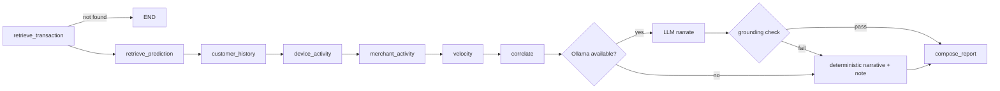

Each node calls a tenant-scoped SQL tool and appends an evidence item with the database IDs it came from.
`correlate` derives indicators **only from evidence data**, and each indicator cites evidence IDs. The LLM may only
rephrase that evidence. Its output is rejected if it cites unknown evidence, cites fewer than two items, or states a
multi-digit number that is not present in the evidence. Without Ollama the platform is fully functional with
deterministic reports, and the UI labels which engine produced each report.

## Testing

| Suite | Count | Command | What it covers |
|---|---|---|---|
| Backend unit | 42 | `make test-unit` | simulator determinism & scenarios, schema validation & every defect type, feature correctness/idempotency/no-future, ML training metrics truthfulness, explanation = real counterfactual, label-free features, PSI, JWT tamper, bcrypt, LLM grounding gate |
| Backend integration | 14 | `make test-integration` | real Postgres/Redis/Redpanda: persistence, **replay creates no duplicates**, conflicting ids, DLQ reasons & no double-quarantine, late events, **Kafka E2E incl. DLQ topic + restart with no reprocessing**, auth, RBAC, **cross-tenant denial**, validation & SQL-injection inertness, **investigation evidence grounding**, dashboard APIs, **dbt build + reconciliation** |
| Frontend unit | 11 | `make test-frontend` | SSE parser (chunk boundaries), formatters, UI primitives, login flow |
| Browser E2E | 7 | `make test-e2e` | login failure, live stats, simulator → Kafka → live feed, investigation + review, all pages, viewer read-only, tenant isolation in the UI |
| Stack smoke | 9 checks | `make smoke` | UI → API → Kafka → consumer → Postgres → predictions → investigation → DLQ → health |
| dbt | 23 tests | runs in `dbt` service | uniqueness, not-null, accepted values, relationships, score bands, reconciliation, tenant attribution |

Last local run: **56/56 backend, 11/11 frontend, 7/7 Playwright, smoke passed, dbt PASS=34 (models + tests)**.

## CI/CD

`.github/workflows/ci.yml` has six jobs:
- **backend** runs ruff lint + format check, mypy and unit tests.
- **integration** runs Postgres and Redis service containers plus Redpanda via `docker run`, then the integration tests including dbt.
- **frontend** runs ESLint, `tsc`, Vitest and the production build.
- **e2e** runs `docker compose build`, brings up the full stack from `.env.example`, then the smoke test and Playwright.
- **docs** renders every Mermaid diagram in `README.md` and `docs/` with the Mermaid CLI (`make check-docs`), so a
  diagram that would not render on GitHub fails the build.
- **secrets** runs a gitleaks scan of the full history.

No job needs API keys or paid infrastructure.

## Security considerations

- Tenant isolation is enforced in SQL: every repository function requires `tenant_id`. Cross-tenant reads return
  **404**, not 403, so they don't reveal that the record exists. Integration and browser tests cover both directions.
- RBAC: viewer (read) < analyst (investigate/review/alert status/run DQ) < admin (simulator, audit log, unattributable dead letters).
- Passwords use bcrypt cost 12. Login does a constant-work comparison for unknown users. Login successes and
  failures are audited.
- JWT (HS256, `iss`, `exp`, required claims). The token travels in the `Authorization` header. The live feed uses
  SSE over `fetch` precisely so the token never goes in a URL.
- SQL is parameterised: SQLAlchemy Core or bound `text()` parameters, with a test showing an injection string is inert.
- `.env` is git-ignored. `.env.example` values are clearly marked **non-production**. The API refuses to start
  with the dev JWT secret when `AEGIS_ENVIRONMENT=production`. Containers run as non-root. nginx sets `nosniff`,
  `DENY` framing and `no-referrer` headers.
- Model artifacts are not committed. They are trained reproducibly at startup.
- Demo caveats: the token is stored in `localStorage` (an httpOnly cookie plus CSRF protection would be the production
  choice), there is no rate limiting on login, and there is no TLS locally.

## Known limitations

- Synthetic data; metrics do not transfer to real fraud. The collusive-merchant and high-value-anomaly scenarios are
  the weakest (see metrics).
- Occlusion explanations ignore feature interactions. With trees, one feature can carry a large share on its own
  (e.g. merchant-category risk).
- Live customers start with no Redis history (cold start). Profile-based features (registered devices, home country,
  typical ticket) mitigate this, and the drift monitor shows the effect.
- One consumer instance and single-broker Redpanda (dev mode). Horizontal scaling is designed for (keyed partitions,
  idempotent writes) but not exercised.
- The Redis write happens just before the DB commit, so a crash in between leaves a Redis entry with no DB row until
  redelivery. That is harmless by design (idempotent, excluded by id) but worth knowing.
- Ollama narration on CPU takes ~30–90 s per investigation. It was verified with `llama3.2:3b`, but it is off by default.
- dbt marts are full rebuilds (fine at demo scale; incremental models would be the next step).

## Future improvements

Incremental dbt models and snapshots · schema registry (Avro/Protobuf) · exactly-once Kafka transactions for the DLQ ·
SHAP/TreeSHAP for interaction-aware explanations · label-feedback topic (chargebacks) and scheduled retraining with
champion/challenger · feature-store backfill for warm starts · httpOnly-cookie auth, rate limiting and OIDC ·
Kubernetes manifests with HPA on consumer lag · OpenTelemetry tracing.

## Repository layout

```
backend/   FastAPI app, streaming producer/consumer, features, ML, LangGraph, Alembic, tests
frontend/  React + TypeScript dashboard, Vitest unit tests, Playwright E2E + screenshot capture
dbt/       dbt Core project (seeds, staging, marts, tests) + result recorder
infra/     Postgres init, Prometheus, Grafana provisioning
scripts/   stack readiness wait + end-to-end smoke test
docs/      architecture, pipeline, ML, API, demo, decisions, screenshots
```

## License

MIT. See [LICENSE](LICENSE).
